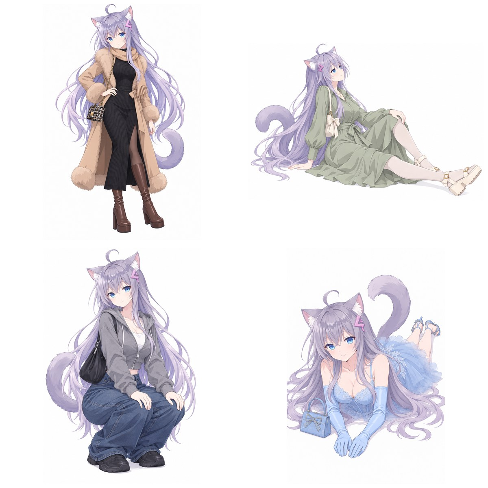

# ai-gallery

**非官方项目 / Unofficial.** 与下列各图库的作者无任何关联，也不代表其立场；本仓库只按各站公开条款取用图片作生成参考，图片本身的版权与授权归各站作者，详见 [references/terms.md](references/terms.md)。

> Reference-image retrieval for AI image / video generation — pose mannequins, depth maps, costumes and faces, fetched by id for GPT Image, Nano Banana, ComfyUI or H3.



同一角色的四个姿势，姿势参考取自 `pose` 库（P015 / P001 / P061 / P007），由 GPT Image 生成。

## 安装

```bash
npx skills add klarkxy/ai-gallery
```

## 用法

装好后直接提需求即可——选库、检索、取图都由 agent 完成。库清单、检索规则与授权边界见 [SKILL.md](SKILL.md)。

## 授权

代码与文档采用 [SATA 2.1](LICENSE)。各图库图片的授权另见 [references/terms.md](references/terms.md)。
